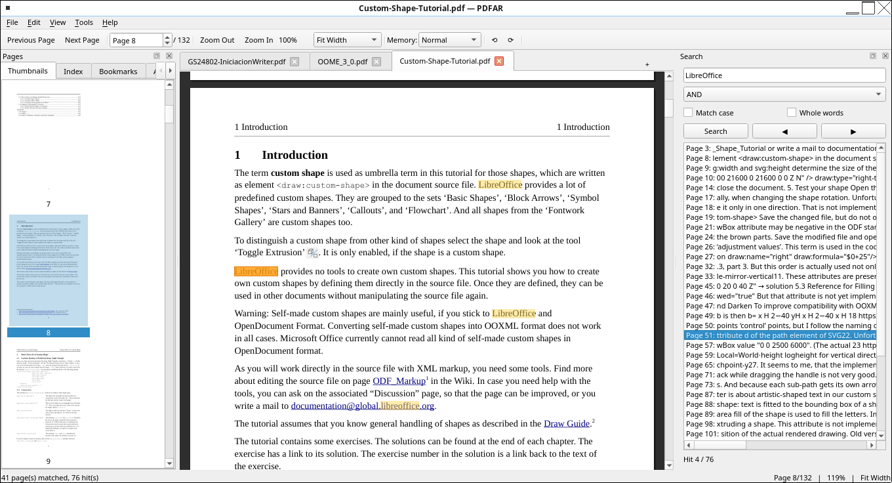

# PDFAR — Advanced PDF Reader for Linux

[](https://www.python.org/)
[](https://www.riverbankcomputing.com/software/pyqt/)
[](https://pymupdf.readthedocs.io/)
[](#-testing)
[](https://www.gnu.org/licenses/gpl-3.0.html)
[](https://www.linux.org/)

**PDFAR** is a fast, native-feeling PDF reader for Linux built with PyQt6 and PyMuPDF. Continuous scrolling, real text selection, instant search with highlighted hits, thumbnails, a document outline, fit modes, rotation, keyboard-first navigation, and a **reflow mode that keeps text, images and tables together** in one readable column.

---

## Why 1.x showed *no pages at all* (and how it is fixed)

The 1.x viewer handed render results back to the GUI like this:

```python
future = self.executor.submit(self._render_page_sync, page_index)
future.add_done_callback(
    lambda f: QTimer.singleShot(0, lambda: self._apply_render_done(f, page_index))
)
```

`add_done_callback` runs **inside the `ThreadPoolExecutor` worker thread**.  
`QTimer.singleShot(0, ...)` creates a timer bound to *the calling thread* — and a pool worker thread has **no Qt event loop**, so the timer never fires. `_apply_render_result()` therefore never ran, no pixmap was ever set, and the document area stayed empty forever. That is the "program does not show any PDF page" bug.

Fixes in 2.0 (there were ten other bugs behind it):

| # | 1.x bug | 2.0 fix |
|---|---------|---------|
| 1 | `QTimer.singleShot` from executor threads → results never delivered | `RenderPool` emits a Qt **signal** from the worker; Qt queues it to the GUI thread |
| 2 | Render results dropped when size rounded >2 px (`width_diff <= 2`) | Always accepted; drawing targets the page rectangle |
| 3 | `_get_visible_page_range()` stopped at the first page → range was 1 page | Real binary-search based range over page tops |
| 4 | `set_zoom()` never recomputed page tops/heights → stale geometry | `_relayout()` recomputes all geometry on every change |
| 5 | `PageCache` existed but was **never written** → every scroll re-rendered | Byte-budget LRU cache, keyed by (page, zoom, rotation) |
| 6 | `SearchWorker.run` never connected to `thread.started` → **search never ran** | Worker properly connected + its own document handle |
| 7 | `done` signal connected to a lambda → UI updated from the worker thread | Bound-method connections ⇒ queued to the GUI thread |
| 8 | One `fitz.Document` shared between threads (not thread-safe) | Every render thread opens its own handle |
| 9 | Highlights painted *into* the cached pixmap (they stacked up) | Overlays painted on top at paint time |
| 10 | `invalidate_zoom()` dropped the *new* zoom's cache instead of the old | Cache keyed per zoom, invalidated correctly |

---

---

## Features

- **Instant rendering** — priority render queue (visible pages first), worker threads with per-thread document handles, LRU bitmap cache (memory-budgeted).
- **Continuous scrolling** with smooth mouse-wheel / keyboard paging.
- **Real text selection** — drag to select across pages and columns, `Ctrl+C` to copy, `Ctrl+A` to select all (text comes from the PDF text layer, works with any rotation).
- **Search** — AND / OR / exact phrase / regex, match-case, whole-words, per-page snippets with the searched words highlighted in yellow, per-mode descriptions with examples when hovering the mode selector or its menu, clickable results that jump to that page's first hit, `F3` / `Shift+F3` to jump between hits. Invalid regexes are reported inline, long searches can be cancelled or superseded safely, and regex scans stop at a time limit. Search lives in the right-hand dock, whose two tabs (Search and Page Numbers) are icon-only with labels on hover.
- **Sidebar** — icon-only tabs (labels appear on hover) for page thumbnails (rendered in the background), the document outline/table of contents with click-to-jump, user bookmarks, annotations and attachments.
- **Zoom** — fit-page, fit-width, and presets `50, 62.5, 75, 87.5, 100, 112.5, 125, 137.5, 150, 162.5, 175, 200, 250, 300, 350, 400 %`; `Ctrl` + mouse wheel zooms around the cursor. A compact **Step** selector (2.5 %–25 %, default 10 %) sets the additive increment used by Zoom In/Out and `Ctrl++`/`Ctrl+-`; `Ctrl` + wheel follows the same step by default and can be switched to fluid zoom in the View menu.
- **Rotation** — 90° steps, with selection and highlights staying on the right words.
- **Encrypted PDFs** — password prompt, credentials are passed to the render workers only.
- **Reflow mode with figures and tables** — single-column reading on any window size; text is extracted and laid out in the background, raster images and detected tables are rendered inline in reading order, two-column papers are read left column first, text size is adjustable, and scanned pages are shown as fit-to-column images.
- **Page numbering** — embedded as a tab in the right-hand dock. Add numbers at any page corner or edge (top/bottom × left/centre/right), finely adjust offsets in points, millimetres, centimetres or inches, pick a common format (`1`, `1/5`, `Page 1 of 5`, …), choose the start and end page and set the first printed number. Numbers can use the built-in Helvetica, Times or Courier faces or any installed system font in any of its styles (Bold, Italic, Light, SemiBold, …), with a **Choose…** dialog that browses recommended and installed families, shows a live sample and suggests the Debian/Ubuntu package for missing recommended fonts. A live mask preview covers the old content behind each number and can be dragged directly on the page to position it; the mask expands independently on each side and takes any colour (presets, a colour dialog or an on-screen eyedropper) to match tinted or non-white paper. An **Erase** sub-tab covers old numbers with a blank, draggable rectangle instead of adding a new one. Saving writes a new `-numbered.pdf` or `-erased.pdf` copy without touching the original.
- **Comfort** — drag & drop to open, open from the command line, recent-file memory, starts maximized by default with an option in **Tools → Settings…** to instead reopen at the remembered window size and position (presentation mode is never saved as the window state), page spinner, status bar.
- **Crisp vector icons** — toolbar and sidebar icons are drawn by a `QIconEngine` at the exact requested size and device pixel ratio (see [`docs/en/developers/ui/vector-icons.md`](docs/en/developers/ui/vector-icons.md)).

### Keyboard shortcuts

| Key | Action |
|-----|--------|
| `Ctrl+O` | Open PDF |
| `Ctrl+F` / `Ctrl+L` | Focus search |
| `F3` / `Shift+F3` | Next / previous search hit |
| `Ctrl++` / `Ctrl+-` | Zoom in / out by the selected Step; reflow text size when reflow is active |
| `Ctrl+0` / `Ctrl+1` / `Ctrl+2` | 100 % / fit width / fit page |
| `Ctrl+Left` / `Ctrl+Right` | Rotate view |
| `Space` / `PgDown` / `PgUp` | Page down / up |
| `Home` / `End` | First / last page |
| `Ctrl+C` / `Ctrl+A` | Copy selection / select all |
| `Ctrl+wheel` | Zoom at cursor, using the Step increment (View ▸ Ctrl+Wheel Uses Zoom Step toggles fluid zoom) |
| `Ctrl+R` | Toggle reflow mode |

---

### Reflow mode: what it can and cannot do

Reflow (`View → Reflow` or `Ctrl+R`) discards the fixed page geometry and
re-wraps the document into one column sized to the window. Text is
re-flowed, and the page's images and detected tables are rendered inline in
reading order, so figures no longer disappear. Extraction, table detection
and figure rendering run on a worker thread with its own document handle, so
opening reflow on a 500-page PDF does not freeze the UI; pages appear as they
are prepared and a progress count is shown in the status bar.

PDF is a fixed-layout format, so reflow is necessarily a best-effort
transformation:

- **Text is reflowed when a text layer exists.** Scanned or image-only PDFs
  have no text to wrap; their page images are shown fit-to-column instead.
  Run OCR on such files to get reflowable text.
- **Reading order follows the page layout.** Multi-column pages are detected
  from the empty vertical corridor (gutter) between two blocks of text, and
  each column is read completely before the next one — the natural order for
  scientific papers, where a figure or table can sit at the top, middle or
  bottom of either column. Page-wide elements (title, abstract, a spanning
  figure or table, a centred heading or page number) split the page into
  bands: a band is read left to right, then the columns below it are read
  left then right. Detection is deliberately conservative — a narrow sidebar,
  a table of contents or ragged text is not mistaken for a second column, and
  when no clear gutter is found the page falls back to the PDF's block order.
  Complex layouts may still look different from the original page.
- **Images are shown inline.** Raster figures are rendered at the column
  width (images narrower than the column keep their natural size and are
  centred) and stay inside the column they belong to. A page-sized image
  beneath a text layer is treated as a background and skipped so the text
  stays reflowable.
- **Ruled tables are shown as figures.** Tables detected from their grid
  lines are rendered as crisp images scaled to the column, preserving
  merges, alignment and styling. Tables without ruling lines are reflowed as
  ordinary text.
- **Zoom and rotation do not apply while reflow is active** — the column is
  sized to the window and re-wraps when the window is resized. Use
  `Ctrl++` / `Ctrl+-` to increase or decrease the text size and `Ctrl+0` to
  reset it; the page and reading position are preserved while the column is
  rebuilt. Figures scale with the text size.
- Returning to normal view restores the original page layout and the page you
  were reading.

### Page numbering

`Tools → Page Numbers…` (or the page icon in the right-hand dock) opens the
numbering panel next to Search. The panel has three sub-tabs — **Position**
(default), **Mask** and **Erase** — so only the controls you are using take
vertical space; the unit selector, page range and save button stay below all
three. It places a number on every page of a chosen range and saves the result
as a **new copy** (`name-numbered.pdf` by default); the file you have open is
never overwritten. The preview is live and drawn on the pages themselves,
following rotation and zoom:

- A **mask** covers whatever was behind the number, so old printed page
  numbers can be hidden in the saved copy. Its four margins (left, right, top,
  bottom) grow it independently, which is useful when the old numbers are
  larger than the new one. The fill colour can be a preset swatch, chosen in a
  colour dialog, or sampled anywhere on screen with **Pick…** — handy when the
  page background is ivory, beige or otherwise tinted.
- Drag the number on the page to position it; the offsets in the panel update
  as you drag, and the mask snaps inside the page edges.
- Offsets can be entered in **pt, mm, cm or in**; switching units keeps the
  physical position unchanged. The unit choice is shared by every sub-tab.
- **Start page number** and **End page number** limit which pages are
  numbered, which is useful for skipping covers or appended documents.
- Common formats are available (`1`, `1/5`, `Page 1`, `Page 1 of 5`,
  `- 1 -`). The total in `1/5` counts only the pages selected for numbering —
  numbering pages 2–5 of a five-page document produces `1/4 … 4/4`. The first
  printed number is also configurable, so a cover can be skipped while the
  next page still starts at 1.
- The **Font** row lists the built-in Helvetica, Times and Courier faces first,
  followed by the recommended families installed on the machine. Pick a
  **Style** (Regular, Bold, Italic, Light, SemiBold, Condensed, …) from those
  the family provides. **Choose…** opens a larger dialog with a searchable
  tree of recommended and installed fonts, their full style list, a size field
  and a live sample; fonts from the recommended catalog that are not installed
  appear greyed out with the `apt install` command that provides them.
  System fonts are embedded in the saved copy, so it renders the same on any
  viewer; the three built-ins need no embedding.
- **Erase** draws a blank rectangle over the selected pages instead of adding
  a number — useful to remove an old header or footer numbering before placing
  new numbers somewhere else. Set its placement, width, height, offsets and
  colour (independent from the numbering mask), or drag it on the page.
  **Save Erased Copy…** writes `name-erased.pdf`. The rectangle hides the old
  content visually; it is not a PDF redaction and the hidden text remains in
  the file.

Selecting the Page Numbers tab switches reflow off temporarily because
numbering refers to physical page geometry; leaving the tab restores reflow.
The copy includes unsaved highlights and annotations, and the original PDF's
rotation (`/Rotate`) is respected. Page numbers are ordinary selectable PDF
text. Implementation notes are in
[`docs/en/developers/ui/page-numbering.md`](docs/en/developers/ui/page-numbering.md).

`demo-two-columns.pdf` in the repository root is a four-page journal-style
paper that exercises this ordering: a page-wide title and abstract, a
full-width figure and table between column bands, and figures and tables
placed at different heights inside individual columns. Open it and press
`Ctrl+R` to compare the reflowed reading order with the original page.
Regenerate it with `python3 tools/demo_pdf/make_two_column_demo.py`; `demo.pdf`
(from `tools/demo_pdf/make_demo_pdf.py`) covers the rest of the feature set.
Open-access research papers used to validate the column detection against
real publisher layouts live in `external/two-column-test-pdfs/` — see its
`CREDITS.md` for sources and CC BY 4.0 attribution.

---

# Quick start

## Dependencies (Debian/Ubuntu)

### **Option 1: System packages (recommended for Debian/Ubuntu)**

```bash
sudo apt update
sudo apt install python3-pyqt6 python3-pymupdf fontconfig
```

### **Option 2: User install via pip (no virtualenv "venv" needed)**

```bash
sudo apt update
sudo apt install python3-pyqt6 fontconfig  # or: pip3 install --user PyQt6
pip3 install --user pymupdf             # PyMuPDF
```

> **Note:** `pip install --user` installs packages to `~/.local/lib/python3.x/site-packages/`, available globally for your user — **no virtualenv activation needed**. 

### Windows and macOS

PDFAR is developed and tested on Linux, but the runtime is pure Python and
the PyPI wheels of Qt and PyMuPDF are available for both systems.

**Windows** (Python 3.9+ from python.org, with *Add python.exe to PATH*
enabled during installation):

```powershell
py -m pip install --user PyQt6 pymupdf
py run.py
```

**macOS** (Python 3.9+ from python.org or Homebrew; a virtualenv avoids the
PEP 668 *externally managed environment* error):

```bash
python3 -m venv venv
source venv/bin/activate
pip install PyQt6 pymupdf
python3 run.py
```

Font discovery adapts to the platform. The **Recommended** group in the font
dialog lists Debian/Ubuntu's open font packages (with `apt` hints) on Linux,
Windows' built-in families (Arial, Calibri, Segoe UI, …) plus the open fonts
on Windows, and macOS' built-in families (Helvetica Neue, Menlo, …) plus the
open fonts on macOS, each with fitting install guidance. System-font embedding
uses fontconfig (`fc-list`) on Linux, the font registry on Windows and the
system Fonts folders on macOS; numbered copies still fall back to a built-in
face when no font file can be found (for example, a face inside a macOS
`.ttc` collection).

### Recommended fonts for page numbering (optional)

Page numbering works out of the box with the built-in Helvetica, Times and
Courier faces and with any font already installed on the system. To see the
families listed under **Recommended** in the font dialog, install them once:

```bash
sudo apt update
sudo apt install fonts-liberation fonts-dejavu fonts-noto-core \
    fonts-roboto fonts-open-sans fonts-lato fonts-inter fonts-montserrat \
    fonts-jetbrains-mono fonts-firacode fonts-ubuntu fonts-cantarell \
    fonts-crosextra-carlito fonts-crosextra-caladea fonts-urw-base35
```

`fonts-ibm-plex` (IBM Plex Sans/Serif/Mono) is in Debian **contrib**: enable
that section first, then `sudo apt install fonts-ibm-plex`. Red Hat Text,
Display and Mono are OFL but not packaged by Debian/Ubuntu; install the
upstream release if you want them. Families that are still missing stay
visible in the dialog, greyed out with their install hint.

#### Run without venv

```bash
python3 run.py          
```

The next screenshot, the program shows three PDFs open in three tabs; in one of them, the word "LibreOffice" is being searched for—a word that appears on many pages of that PDF:




or alternatively, for users who like using the terminal for many things:

```bash
python3 run.py /path/to/file.pdf    # open a document directly
```

**Option 3: Virtual environment (OPTIONAL if you need for development / isolated environments)**

Use a virtualenv only if you need isolated environments for development:

```bash
python3 -m venv venv
source venv/bin/activate
pip install PyQt6 pymupdf
```

####  Run in venv

```bash
python3 run.py          
```

### Debian packaging note

The program works with both the system package `python3-pymupdf` (Debian/Ubuntu repos) and the PyPI package `pymupdf` (via pip). The code uses `import fitz` which works with both the system package `python3-pymupdf` and the PyPI package `pymupdf` since both provide the `fitz` module.

### Install as a package (optional)

```bash
pip3 install --user .
pdfar /path/to/file.pdf
```

### Development-only extras (not needed to run PDFAR)

The application itself needs only PyQt6 and PyMuPDF. **ReportLab** is not a
runtime dependency: `tools/demo_pdf/make_demo_pdf.py` uses it, together with
Pillow and CairoSVG, to regenerate the bundled demo fixtures. On Debian/Ubuntu:

```bash
sudo apt install python3-reportlab python3-pil python3-cairosvg
# equivalent pip install: reportlab pillow cairosvg
```

`librsvg2-bin` (the `rsvg-convert` binary) can replace CairoSVG for
rasterising the SVG figures. LibreOffice is optional and only used to rebuild
the `.ods` file attached to the demo PDF.

Running the test suite needs the `test` extra:

```bash
pip3 install --user '.[test]'   # pytest, pytest-qt, pytest-cov, hypothesis, typeguard
```

---

## Large / Scanned PDF Performance Breakthrough

PDFAR underwent a dedicated **performance engineering milestone** targeting large and scanned PDFs. The rendering pipeline was redesigned around **demand-driven rendering**: render what the user currently needs first, avoid unnecessary work, cancel obsolete work, reuse rendered data, and keep memory usage bounded.

### Verified Benchmark Results

Testing with the 540-page LibreOffice Getting Started Guide (24 MB, heavy images):

| Metric | Before | After | Improvement |
|---|---:|---:|---:|
| open_document_time | 2.78 s | 1.96 s | **30% faster** |
| jobs_queued_during_open | 2,052 | 0 | **Eliminated** |
| time_to_first_page | 41.47 s | 0.66 s | **63x faster** |
| time_to_viewport_complete | 0.36 s | 0.0003 s | **1200x faster** |
| jump_to_distant_page | 0.96 s | 0.43 s | **2.2x faster** |
| zoom_sequence (100%→200%→300%) | 19.4 s | 1.81 s | **10.7x faster** |
| peak_rss_mb | 4,783 MB | 642 MB | **7.5x less memory** |

> **Note:** These results come from the project's performance benchmark (`tools/benchmark.py`) on a specific test PDF and hardware. They should not be presented as universal performance guarantees for every PDF or every machine.

### Major Technical Improvements

1. **Raw pixel buffer transport** — Replaced the PNG encode/decode round-trip with direct pixel buffer transfer. Worker threads now return raw `pix.samples` bytes + stride + format; the GUI thread constructs `QImage` directly. This removed ~180x PNG overhead.

2. **Lazy, viewport-aware thumbnail rendering** — Thumbnails are now only rendered for visible sidebar items. Opening a 540-page document queues ~5 thumbnails instead of all 540. Scroll/tab-change triggers lazy loading with a small margin; stale thumbnail jobs are cancelled when scrolling away.

3. **Correct memory-level default** — Fixed a bug where "greedy" memory level persisted from a previous session, causing full-document preloading on every open. Default is now "normal" (viewport + small prefetch).

4. **Faster page metadata access** — Changed `doc.load_page(i).rect` → `doc[i].rect` (~3x faster page size enumeration).

5. **Per-worker DisplayList caching** — Workers reuse `page.get_displaylist()` for repeated zooms/tiles (~2x speedup for zoom changes).

6. **Visible-content-first rendering architecture** — The first visible page receives absolute priority; background work is deprioritized and cancellable.

7. **Reduced unnecessary work during document opening** — Annotation scanning, thumbnail creation, and full-document layout are deferred or made lazy.

See `docs/en/developers/performance/large-pdf-performance.md` for the full technical deep-dive.

```
---

## Performance (measured)

On a 200-page A4 document (headless container, one page per page of text and charts): open ≈ 0.31 s, first page painted ≈ 0.22 s, jump to page 200 + render ≈ 0.13 s, zoom 100 %→300 % + render ≈ 0.5 s. The bitmap cache is bounded by memory (256 MB default) rather than by page count.

### Architecture notes

- **Rendering** happens off the GUI thread in `RenderPool` worker threads (priority queue → visible pages first). Results are PNG buffers, converted to `QImage` on the GUI thread — `QPixmap`/`QImage` must never be touched from worker threads.
- **Painting** is done directly in `PDFView.paintEvent`, so partial updates are cheap and overlays (highlights, selection) never corrupt the cached page.
- **Geometry** (`geometry.py`) is pure Python: all rotation/coordinate mapping is unit-tested so text selection and highlights cannot drift out of sync.
- **Icons** (`icons.py`) are vector-rendered on demand by a `QIconEngine` at the exact requested size and device pixel ratio; pre-rasterizing them into fixed sizes made Qt rescale 18 px icons and softened their strokes.
- **Page numbering** (`page_numbers.py`) is non-destructive: the open document is serialized with `tobytes()` (including unsaved annotations), numbers are stamped on a temporary copy, and the result is moved into place atomically. Layout works in display space and is converted with page.derotation_matrix + insert_text(rotate=…), so pages with `/Rotate` get numbers at the visual corner. The same `NumberBox` geometry (including its asymmetric per-side mask pads) drives the coloured mask, the dashed preview, hit-testing and drag updates, so what you drag is exactly what gets stamped. The erase mode reuses that geometry with zero pads: `erase_box()` returns a plain rectangle, and `erase_copy()` fills it with the chosen colour on the selected pages.
- **Fonts** (`fonts.py`) use Qt to discover installed families and styles, `fc-list` to map a family/style to its file, and `insert_font(fontfile=…)` to embed that file in the numbered copy. Availability must come from `QFontDatabase` rather than `fc-match`, because `fc-match` silently substitutes a different family for a missing one.

---

## Testing

The test suite runs fully headless (`QT_QPA_PLATFORM=offscreen`) and covers the regression that caused the blank-page bug:

```bash
python3 -m pytest tests/ -v
```

Highlights:

- `test_render.py::test_results_are_delivered_to_gui_thread` — render results really reach the GUI thread (the exact 1.x failure).
- `test_viewer.py::test_pages_actually_render_and_paint` — pixels of a known black square must be visible in the painted widget.
- `test_viewer.py::test_rotation_render_matches_geometry` — rendered bitmaps and the geometry helpers agree on rotation direction.
- `test_viewer.py::test_drag_selection_and_copy` — real mouse-drag selection.
- `test_page_numbers.py` — formats, numbered-page totals, unit conversion, rotated-page stamping, per-side mask geometry and colour (including the screen eyedropper), the Position/Mask/Erase sub-tabs, the erase mask and erased-copy flow, the draggable preview, the icon-only right-hand tabs, and the save-a-copy flow.
- `test_fonts.py` — recommended catalog and package hints, base-14 style aliases, family/foundry resolution, style matching (including condensed avoidance), embedded system-font stamping, preview styling, and the font dialog and panel controls.

---

## Debian packaging

See `DEBIAN.md`. A `debian/` directory with `changelog`/`copyright` is included as a starting point for building a `.deb`.

---

## Translations

`i18n.py` loads `translations/pdfar_<lang>.qm` (Qt Linguist) at startup when a file for the system locale exists. The UI strings are currently English; adding a language only requires producing a `.qm` file — no code changes.

---

## License

**GPL-3.0** — see [LICENSE](LICENSE) for details.

---

```
PDF-Advanced-Reader/
├── src/pdfar/          # Main application code
│   ├── __init__.py     # Package metadata
│   ├── main.py         # Main window and UI
│   ├── search.py       # Search logic
│   ├── viewer.py       # PDF rendering component
│   ├── page_numbers.py # Page numbering, erase mask, panel, preview, exports
│   ├── fonts.py        # Installed-font catalog, style matching and embedding
│   ├── cache.py        # Page caching
│   └── i18n.py         # Internationalization support
├── translations/       # Qt Linguist translation files
│   ├── pdfar_en.ts
│   └── pdfar_es.ts
├── debian/             # Debian packaging metadata (future)
├── run.py              # Entry point
├── compile_ts.py       # Translation compiler
└── README.md
```

---

## Internationalization

PDFAR supports multiple languages through Qt Linguist:

| Language | Status |
|----------|--------|
| **English** | ✅ Primary |
| **Spanish** | ✅ Complete |
| **More** | 🔧 Extend via `.ts` files |

Add a new language:

1. Copy `pdfar_es.ts` → `pdfar_xx.ts`
2. Edit with Qt Linguist: `linguist pdfar_xx.ts`
3. Compile: `python3 compile_ts.py`

---

## Development

### Translate a New String

In Python code:

```python
# Use strings that are already in English
self.setWindowTitle("PDFAR - Advanced PDF Reader")
```

### Compile Translations

```bash
python3 compile_ts.py
```

---

## Roadmap

- [x] Thumbnail sidebar navigation
- [ ] Persistent annotations (saved highlights/notes)
- [ ] Export search results
- [x] Dark mode support
- [ ] Full Debian package

---

## Acknowledgements

This project owes a great debt to **Okular** (https://apps.kde.org/okular/), the
mature KDE document viewer (GPL-2.0+ / GPL-3.0+, by KDE and its contributors,
https://invent.kde.org/graphics/okular).

In particular, the tiled-rendering strategy that lets PDF-Advanced-Reader
display heavy, scanned PDFs smoothly at high zoom (render only the visible
tiles of a large page instead of one giant bitmap) was **directly inspired by
Okular's `TilesManager`** (see `core/document.cpp` in the Okular source). PDFAR
studied Okular's architecture and re-implemented the same *ideas* from scratch
in Python/PyQt6/PyMuPDF. Without Okular's proven approach, we would not have
solved this — thank you to the Okular developers.

The **page view modes** (Single Page, Facing Pages, Facing Pages — Center First
Page, Overview and Continuous) also follow the layout model of Okular's
`PageView` (`part/pageview.cpp`, `conf/okular.kcfg`). Page pairing, the
centered first and last pages, the three-column Overview, fit-to-spread and
row navigation were studied there and re-implemented from scratch in
Python/PyQt6. No Okular source code was copied, compiled or linked; only the
behaviour and ideas were reused, which is compatible with both projects' GPL
licenses.

---

## License

**GPL-3.0** — See [LICENSE](LICENSE) for details.

---

## Author

**Washington Indacochea Delgado**  
Email: linuxfrontier@proton.me

---

## Contributing

Contributions are welcome! Please follow these steps:

1. Fork the repository
2. Create a feature branch
3. Submit a pull request.